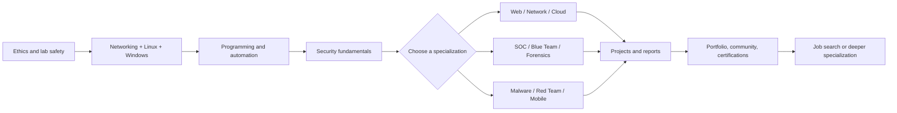

<h1 align="center">Learn-Hacking</h1>

  A free, structured, and practical cybersecurity curriculum — from your first Linux command to professional, authorized security work.

  
  
  
  
  

  <strong>Learn the fundamentals. Practice in safe labs. Understand the defense. Do it ethically.</strong>

---

## Why this repository exists

Cybersecurity education is often fragmented into expensive bootcamps, disconnected video lists, and tool tutorials that skip the theory. This repository is an attempt to do better:

- **A real curriculum**, not a pile of links. Every guide explains concepts, sequences the learning, and names evidence you should produce.
- **Free first.** Core paths can be completed without buying a course. Freemium resources are labelled with exactly what is free.
- **Beginner accessible, advanced useful.** Foundations start from zero; specialization guides go deep enough for working professionals.
- **Practice included.** Labs, drills, projects, report templates, and checklists turn knowledge into demonstrable skill.
- **Defense included.** Every offensive topic is paired with detection, remediation, and professional responsibility.
- **Maintainable.** Resource metadata, link automation, and contribution standards keep the repository from becoming a dead bookmark collection.

> **New to all of this?** Read [Start here](#start-here), then follow the [12-week starter curriculum](LEARNING-GUIDE.md#a-12-week-starter-curriculum). You do not need a degree, a powerful computer, or paid tools to begin.

## Table of contents

- [Start here](#start-here)
- [What is inside](#what-is-inside)
- [Learning roadmaps](#learning-roadmaps)
- [Core learning tracks](#core-learning-tracks)
- [Additional specializations](#additional-specializations)
- [Hands-on training grounds](#hands-on-training-grounds)
- [Free courses and documentation](#free-courses-and-documentation)
- [Practical projects](#practical-projects)
- [Drills, checklists, and templates](#drills-checklists-and-templates)
- [Certifications](#certifications)
- [Suggested learning sequence](#suggested-learning-sequence)
- [How to use this repository](#how-to-use-this-repository)
- [Ethics and legal boundaries](#ethics-and-legal-boundaries)
- [Contributing and community](#contributing-and-community)
- [License](#license)

## Start here

Pick the row that sounds most like you. You can change paths later; the foundations are shared.

| If you are… | Start with | Then | First portfolio artifact |
|---|---|---|---|
| **Completely new to IT** | [Cybersecurity fundamentals](foundations/cybersecurity-fundamentals/README.md) + [Linux](foundations/linux/README.md) | [Beginner to ethical hacker](roadmaps/beginner-to-ethical-hacker.md) | A documented home lab and Linux notes |
| **A developer or sysadmin** | [Web security](roadmaps/web-security-specialist.md) or [Cloud security](roadmaps/cloud-security-engineer.md) | Relevant specialization guide | A threat model or cloud review |
| **A student choosing a career** | [Career development](additional-topics/career-development/README.md) | [Roadmaps](roadmaps/README.md) | A 90-day learning plan and one project |
| **Blue-team or SOC curious** | [SOC and blue team](soc-blue-team/README.md) | [SOC analyst roadmap](roadmaps/soc-analyst.md) | Five triaged alerts with case notes |
| **Offensive-security focused** | [Ethical hacking](ethical-hacking/README.md) + [Networking](foundations/networking/README.md) | [Network pentester](roadmaps/network-pentester.md) or [Red team](roadmaps/red-team-operator.md) | An authorized lab report with remediation |
| **Returning after a break** | [Learning guide](LEARNING-GUIDE.md) | A single specialization roadmap | A skills inventory and gap plan |

**Three rules before you begin**

1. Read [ETHICS.md](ETHICS.md). Only test systems you own or have explicit written authorization to test.
2. Build an isolated lab using [Project 1](practical-projects/01-home-lab.md) and the [home lab checklist](checklists/home-lab.md).
3. Learn in public if you can: keep a sanitized lab notebook, not a screenshot collection.

## What is inside

| Area | What you get |
|---|---|
| **Foundations** | Networking, Linux, Windows, programming, security fundamentals, and ethics |
| **Ten core specializations** | Ethical hacking, network pentesting, web, mobile, wireless, cloud, forensics, malware, SOC/blue team, red team |
| **Sixteen additional-topic directories** | Bug bounty, Active Directory/Windows Server, Linux security, cryptography, OSINT, IoT, hardware, blockchain, AI security, DevSecOps, AppSec, exploit dev, threat intel, architecture, GRC, career |
| **Twelve roadmaps** | Role-based sequences with free resources, labs, milestones, projects, and certifications |
| **Curated resources** | Free courses, training grounds, open-source tools, official docs, books, certs, CTFs, communities, and machine-readable metadata |
| **Twelve projects** | Home lab, hardening, monitoring, SIEM, web assessment, reporting, incident response, forensics, malware, cloud, secure app, portfolio |
| **Workbooks** | Twenty-plus drills per domain, operational checklists, report templates, and a 100+ term glossary |
| **Automation** | Markdown lint, internal anchor checks, external link audits, structure validation, and spell checking |

## Learning roadmaps

Each roadmap is a sequence, not a guarantee. Durations assume 8-10 focused hours per week and are deliberately broad.

| Roadmap | Target role or outcome | Typical focused duration |
|---|---|---|
| [Beginner to ethical hacker](roadmaps/beginner-to-ethical-hacker.md) | Broad offensive foundation with reporting skills | 9-15 months |
| [Network penetration tester](roadmaps/network-pentester.md) | Internal/external network assessment | 9-15 months |
| [Web security specialist](roadmaps/web-security-specialist.md) | Application security testing and secure code review | 8-14 months |
| [Mobile security specialist](roadmaps/mobile-security-specialist.md) | Android/iOS app assessment | 9-15 months |
| [Cloud security engineer](roadmaps/cloud-security-engineer.md) | Cloud identity, detection, and secure architecture | 8-14 months |
| [Digital forensics investigator](roadmaps/digital-forensics.md) | Forensic acquisition, analysis, and reporting | 9-15 months |
| [Malware analyst](roadmaps/malware-analyst.md) | Safe static/dynamic analysis and detection | 10-18 months |
| [SOC analyst](roadmaps/soc-analyst.md) | Alert triage, monitoring, and incident support | 6-12 months |
| [Blue team engineer](roadmaps/blue-team-engineer.md) | Detection engineering, hardening, and response | 9-16 months |
| [Red team operator](roadmaps/red-team-operator.md) | Authorized adversary emulation and reporting | 12-24 months |
| [Bug bounty hunter](roadmaps/bug-bounty-hunter.md) | Scope-aware web security research | 9-18 months |
| [Cybersecurity engineer](roadmaps/cybersecurity-engineer.md) | Cross-domain security engineering | 12-20 months |

New to roadmaps? Read [how to use them](roadmaps/README.md), then choose **one** primary path.

## Core learning tracks

### Foundations

| Track | What it covers |
|---|---|
| [Networking](foundations/networking/README.md) | TCP/IP, DNS, HTTP, TLS, routing, segmentation, packet analysis |
| [Linux](foundations/linux/README.md) | Shell, permissions, processes, services, logs, hardening basics |
| [Windows](foundations/windows/README.md) | NTFS, registry, identity, event logs, PowerShell, Active Directory basics |
| [Programming](foundations/programming/README.md) | Python, Bash, JavaScript, SQL, APIs, testing, secure coding |
| [Cybersecurity fundamentals](foundations/cybersecurity-fundamentals/README.md) | CIA triad, risk, threats, controls, defense in depth, zero trust |
| [Security ethics](foundations/security-ethics/README.md) | Authorization, scope, law, disclosure, privacy, professional conduct |

### Offensive and application security

| Track | Focus |
|---|---|
| [Ethical hacking](ethical-hacking/README.md) | Engagement lifecycle, methodology, evidence, reporting |
| [Network penetration testing](network-penetration-testing/README.md) | Enumeration, network assessment, segmentation, firewall/IDS |
| [Web application security](web-application-security/README.md) | OWASP Top 10, APIs, access control, secure coding, bug bounty |
| [Mobile security](mobile-security/README.md) | Android/iOS architecture, MASVS/MASTG, app analysis |
| [Wireless security](wireless-security/README.md) | 802.11, WPA2/WPA3, Bluetooth, monitoring, router hardening |
| [Red team](red-team/README.md) | Rules of engagement, adversary emulation, detection validation |

### Defensive and specialist security

| Track | Focus |
|---|---|
| [Cloud security](cloud-security/README.md) | AWS/Azure/GCP identity, logging, containers, misconfiguration |
| [Digital forensics](digital-forensics/README.md) | Forensic soundness, artifacts, memory, timelines, reporting |
| [Malware analysis](malware-analysis/README.md) | Isolated analysis, reverse engineering basics, IOCs, YARA |
| [SOC and blue team](soc-blue-team/README.md) | SIEM, triage, threat hunting, detection engineering, IR |

## Additional specializations

These directories cover the subjects requested beyond the ten core tracks:

| Topic | Guide |
|---|---|
| Bug bounty hunting | [Bug bounty](additional-topics/bug-bounty/README.md) |
| Active Directory and Windows Server security | [Active Directory](additional-topics/active-directory/README.md) |
| Linux security | [Linux security](additional-topics/linux-security/README.md) |
| Cryptography | [Cryptography](additional-topics/cryptography/README.md) |
| OSINT | [OSINT](additional-topics/osint/README.md) |
| IoT security | [IoT security](additional-topics/iot-security/README.md) |
| Hardware security | [Hardware security](additional-topics/hardware-security/README.md) |
| Blockchain and smart contracts | [Blockchain security](additional-topics/blockchain-security/README.md) |
| AI and LLM security | [AI security](additional-topics/ai-security/README.md) |
| DevSecOps | [DevSecOps](additional-topics/devsecops/README.md) |
| Application security and secure SDLC | [Application security](additional-topics/application-security/README.md) |
| Exploit development | [Exploit development](additional-topics/exploit-development/README.md) |
| Threat intelligence | [Threat intelligence](additional-topics/threat-intelligence/README.md) |
| Security architecture | [Security architecture](additional-topics/security-architecture/README.md) |
| Governance, risk, and compliance | [GRC](additional-topics/governance-risk-compliance/README.md) |
| Career development | [Career development](additional-topics/career-development/README.md) |

See the [additional-topics index](additional-topics/README.md) for how they fit together.

## Hands-on training grounds

The fastest way to learn is to practice where failure is safe. Start with free platforms and progress deliberately.

| Level | Recommended starting points |
|---|---|
| **Beginner** | [OverTheWire Bandit](https://overthewire.org/wargames/bandit/), [PortSwigger Academy](https://portswigger.net/web-security), [picoCTF](https://picoctf.org/), [Hacker101](https://www.hacker101.com/), [TryHackMe free rooms](https://tryhackme.com/), [OWASP Juice Shop](https://owasp.org/www-project-juice-shop/) |
| **Intermediate** | [Hack The Box](https://www.hackthebox.com/), [Root-Me](https://www.root-me.org/?lang=en), [CyberDefenders](https://cyberdefenders.org/), [Blue Team Labs Online](https://blueteamlabs.online/), [VulnHub](https://www.vulnhub.com/), [KC7 Cyber](https://kc7cyber.com/) |
| **Advanced** | [pwn.college](https://pwn.college/), advanced PortSwigger labs, Hack The Box Pro Labs/CTFs, [Atomic Red Team](https://github.com/redcanaryco/atomic-red-team), forensic and malware training ranges |

Full details, cost labels, prerequisites, and a four-week starter plan:

- [Training grounds overview](resources/training-grounds/README.md)
- [Beginner training](resources/training-grounds/beginner.md)
- [Intermediate training](resources/training-grounds/intermediate.md)
- [Advanced training](resources/training-grounds/advanced.md)

> **Platform access changes.** We label free, free-account, freemium, and paid access. Always check the provider's current terms before paying. A free account is not required to read this repository.

## Free courses and documentation

The [free course directory](resources/free-courses/README.md) contains curated, cost-labelled learning across foundations and specializations. The [documentation library](resources/documentation/README.md) links primary sources such as OWASP, NIST, MITRE, CISA, IETF, Microsoft Learn, AWS documentation, and Google Cloud architecture guidance.

Other curated collections:

- [Open-source security tools](resources/open-source-tools/README.md)
- [Books, free and paid](resources/books/README.md)
- [Official documentation](resources/documentation/README.md)
- [Certifications and free prep](resources/certifications/README.md)
- [CTF platforms](resources/ctf-platforms/README.md)
- [Communities and conferences](resources/communities/README.md)

## Practical projects

Projects are where knowledge becomes evidence. Every project includes objectives, setup, tasks, expected results, deliverables, troubleshooting, and portfolio guidance.

| Project | Skills |
|---|---|
| [01. Build a home lab](practical-projects/01-home-lab.md) | Virtualization, isolation, snapshots, documentation |
| [02. Harden Linux](practical-projects/02-linux-hardening.md) | Least privilege, SSH, services, auditing, verification |
| [03. Network monitoring](practical-projects/03-network-monitoring.md) | Packet capture, Zeek/Suricata, baselining, alerts |
| [04. SIEM investigation](practical-projects/04-log-analysis-siem.md) | Log ingestion, queries, triage, timelines |
| [05. Web vulnerability assessment](practical-projects/05-web-vuln-assessment.md) | Safe testing, evidence, OWASP mapping |
| [06. Security report](practical-projects/06-security-report.md) | Risk communication, CVSS caveats, remediation |
| [07. Incident investigation](practical-projects/07-incident-investigation.md) | Scoping, timeline, containment, lessons learned |
| [08. Forensics timeline](practical-projects/08-forensics-timeline.md) | Forensic soundness, artifacts, correlation |
| [09. Malware analysis report](practical-projects/09-malware-analysis-report.md) | Safe analysis, behavior, IOCs, detection |
| [10. Cloud security review](practical-projects/10-cloud-security-review.md) | IAM, logging, network, storage, IaC |
| [11. Secure web app](practical-projects/11-secure-web-app.md) | Security requirements, secure coding, tests |
| [12. Security portfolio](practical-projects/12-security-portfolio.md) | Sanitization, storytelling, professional evidence |

Start with [Project 1](practical-projects/01-home-lab.md), even if you already have a lab. It establishes safety and documentation habits.

## Drills, checklists, and templates

- **Drills:** [Linux](exercises/linux-drills.md), [networking](exercises/networking-drills.md), [web security](exercises/web-security-drills.md), and [blue team](exercises/blue-team-drills.md).
- **Checklists:** [pre-engagement](checklists/pre-engagement.md), [web assessment](checklists/web-assessment.md), [incident response](checklists/incident-response.md), [cloud review](checklists/cloud-review.md), and [home lab](checklists/home-lab.md).
- **Templates:** [vulnerability report](templates/vulnerability-report.md), [penetration test report](templates/penetration-test-report.md), [incident report](templates/incident-report.md), and [lab notes](templates/lab-notes.md).
- **Glossary:** [100+ cybersecurity terms](glossary/README.md).

## Certifications

Certifications are optional signals, not substitutes for skill. The [certification guide](resources/certifications/README.md) separates free study from paid exams and maps certifications to roadmaps.

Good first areas to explore:

- **Fundamentals:** ISC2 Certified in Cybersecurity (CC), CompTIA Security+, Cisco CCST Cybersecurity.
- **Cloud:** Microsoft SC-900/AZ-500, AWS Certified Security – Specialty, Google Professional Cloud Security Engineer.
- **Offensive:** PNPT, OSCP, eJPT, HTB certifications — all paid; free preparation resources are listed.
- **Blue team:** BTL1, CySA+, Microsoft SC-200.
- **Forensics/malware:** GCFA, GCFE, GREM — advanced and expensive; build skills first.

Do not use exam dumps. Employers increasingly use practical interviews; a certificate with no portfolio is fragile evidence.

## Suggested learning sequence

A practical first year:

1. **Weeks 1-6:** ethics, networking, Linux, Windows basics, one programming language.
2. **Weeks 7-10:** security fundamentals and web basics; start a lab notebook.
3. **Weeks 11-16:** choose one specialization; complete beginner labs and two projects.
4. **Weeks 17-24:** intermediate labs, a substantial project, and a sanitized report.
5. **Weeks 25-36:** deepen the specialization, contribute or publish, prepare for interviews.
6. **Ongoing:** detection literacy, cloud awareness, and a second specialization.

See the full [learning guide](LEARNING-GUIDE.md) for study techniques and a week-by-week plan.

## How to use this repository

1. **Star and fork** the repository if it is useful. Forking lets you adapt the curriculum.
2. **Read the ethics page** before touching any security tool.
3. **Choose one roadmap** from [roadmaps/](roadmaps/README.md).
4. **Build the lab** and keep a [lab notebook](templates/lab-notes.md).
5. **Work in small loops:** learn one concept, practice it, produce evidence, review.
6. **Use the checklists and templates** so your work resembles professional practice.
7. **Contribute back** when you find a better free resource or a clearer explanation.

### Quality and freshness

This repository is not a static link dump. It uses:

- automated Markdown linting;
- internal link and heading-anchor validation;
- weekly external link audits;
- resource metadata checks;
- structure and content validation;
- human review for technical accuracy and safety.

See the [resource format](resources/RESOURCE-FORMAT.md) and the [quality workflow](.github/workflows/quality.yml).

## Ethics and legal boundaries

This project exists for **legitimate education, defensive security, and authorized testing**.

- Only practice on systems you own or have **explicit, written permission** to test.
- Never attack, scan, or access real systems without authorization.
- Follow applicable laws, contracts, platform rules, and responsible disclosure requirements.
- Use isolated virtual machines and controlled labs for potentially dangerous experiments.
- Do not use these materials for malware, harassment, fraud, or unauthorized access.
- Handle other people's data with privacy and care.

Read the full [ethics, law, and responsible practice guide](ETHICS.md). It is educational guidance, not legal advice. If you are unsure whether an action is authorized: **stop and ask**.

## Contributing and community

Contributions are welcome from learners, educators, practitioners, and translators.

- Read [CONTRIBUTING.md](CONTRIBUTING.md) and the [Code of Conduct](CODE_OF_CONDUCT.md).
- Suggest a resource through the [issue templates](https://github.com/6t9xstar/learn-hacking/issues/new/choose).
- Report unsafe content through [SECURITY.md](SECURITY.md), not a public issue.
- Improve a guide, add a lab, fix a link, or translate a page.
- Be patient and constructive in review. This is a volunteer-maintained project.

If this repository helps you, consider starring it so other learners can find it, and share a sanitized project or write-up with the community.

## License

Released under the [MIT License](LICENSE). You may use, adapt, and teach from this material with attribution. Third-party resources retain their own licenses and terms.

---

  <strong>Learn deeply. Practice safely. Defend others. Stay curious.</strong>

  <a href="LEARNING-GUIDE.md">Learning guide</a> ·
  <a href="roadmaps/README.md">Roadmaps</a> ·
  <a href="resources/README.md">Resources</a> ·
  <a href="practical-projects/README.md">Projects</a> ·
  <a href="CONTRIBUTING.md">Contribute</a>

